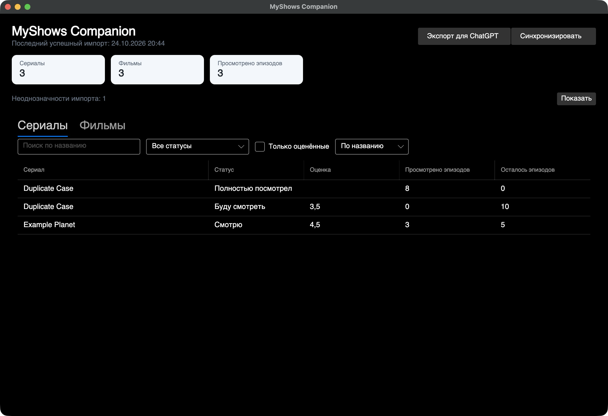
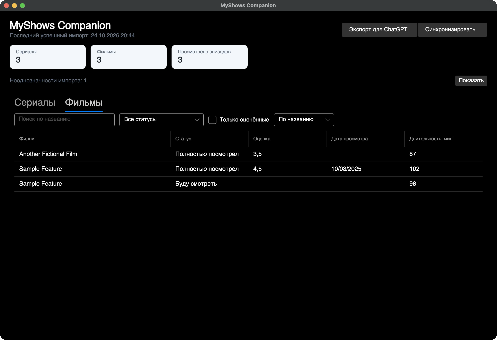
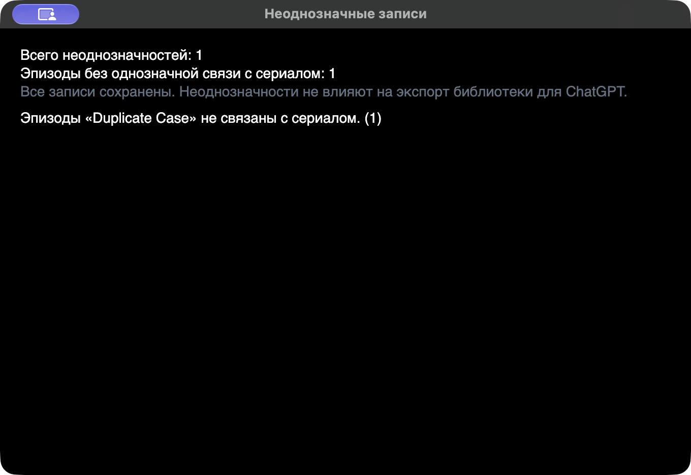

# MyShows Companion

**A local-first macOS desktop companion for importing and organizing MyShows profile exports.**

MyShows Companion turns an official MyShows profile `.xlsx` export into a searchable local library of series, movies, and watched episodes. It is a personal desktop app: it does not sign in to MyShows or synchronize with its website.

## The problem

Profile exports are useful snapshots, but they are cumbersome to browse and compare over time. This app imports that workbook into a local SQLite database, lets you search and filter the library, and can create a compact JSON summary for optional use in ChatGPT.

## Features

- Import the official workbook sheets `Сериалы`, `Эпизоды`, and `Фильмы`.
- Browse series and movies with title search, status and rating filters, and sorting.
- Keep watched-episode progress and viewing dates from the episode sheet.
- Record import runs and show records that could not be matched safely.
- Export a versioned, ChatGPT-friendly JSON library without episode history.
- Build a self-contained macOS arm64 application bundle.

## Screenshots

All screenshots use a disposable database created only from the fictional workbook in [`samples/myshows-profile-sample.xlsx`](samples/myshows-profile-sample.xlsx). They contain no real profile data.







See [`docs/screenshots/README.md`](docs/screenshots/README.md) for the sample-data workflow.

## Architecture and tech stack

- **.NET 8 / C#** — domain, importer, local services, and desktop client.
- **Avalonia** — cross-platform UI toolkit; the packaged target is macOS arm64.
- **SQLite** — the desktop app's local source of truth, stored in the user's Application Support directory.
- **ClosedXML** — XLSX workbook parsing.
- **System.Text.Json** — versioned library export.

Solution layout:

```text
src/
  MyShowsCompanion/          Domain, XLSX import, SQLite store, queries, JSON export
  MyShowsCompanion.Desktop/  Avalonia desktop application
tests/                       Import, storage, query, and export tests
samples/                     Fictional MyShows-format workbook
packaging/macos/              macOS app bundle metadata and build script
docs/screenshots/             Screenshot capture checklist
```

## Import flow

Choose an official MyShows `.xlsx` file with the three Russian-named sheets and expected column headers. The source workbook is read without modification. Imports are transactional and idempotent for the same SHA-256 file. Later exports update safely matched rows and add new ones.

The export does not contain MyShows IDs. Matching therefore does not use title as a global unique key: unique titles within a type can be matched, while duplicate-title rows need a unique additional signal. Ambiguous records remain separate and are reported instead of being silently merged. Episode ratings present in the workbook are ignored by the domain model.

## ChatGPT export

The **Export for ChatGPT** action reads the current local database and saves a UTF-8 JSON file with `schemaVersion: 1`, summary statistics, series, and movies. It includes local IDs, titles, normalized statuses, ratings, and available progress or watched-date fields. It does not include episode history, episode ratings, import history, or warnings. The app does not upload the file; the user chooses whether and where to share it.

## Privacy and local-first design

- No MyShows account, password, browser session, or website scraping is used.
- Imported library data and import metadata are stored locally in SQLite.
- The desktop database is located under `~/Library/Application Support/MyShowsCompanion/`.
- The source `.xlsx` is not changed by import.
- JSON export is an explicit user action and remains a local file unless the user shares it separately.
- Real exports, generated library JSON, SQLite files, app bundles, and build output are excluded by `.gitignore`.

## Build and run

Requirements: .NET 8 SDK. For the native macOS bundle, use an Apple Silicon Mac with Xcode command-line tools (for `swift` and `iconutil`).

Run the desktop application during development:

```sh
dotnet restore MyShowsCompanion.slnx
dotnet run --project src/MyShowsCompanion.Desktop
```

Create a release build:

```sh
dotnet build MyShowsCompanion.slnx --configuration Release
```

Create a self-contained macOS arm64 `.app` bundle:

```sh
bash packaging/macos/build-app.sh
```

The script creates `MyShows Companion.app` in the project root and refuses to overwrite an existing bundle. The current icon is a placeholder. The bundle is unsigned and not notarized.

To smoke-test the sample workbook without writing a database into the repository, copy it to a temporary directory first:

```sh
sample_dir="$(mktemp -d)"
cp samples/myshows-profile-sample.xlsx "$sample_dir/profile.xlsx"
dotnet run --project src/MyShowsCompanion -- "$sample_dir/profile.xlsx"
```

The importer writes its disposable SQLite database next to the copied workbook. Remove the temporary directory when finished.

## Tests

Run the full test suite:

```sh
dotnet test MyShowsCompanion.slnx
```

## Known limitations

- Only the documented official XLSX layout and Russian sheet/header names are supported.
- MyShows exports do not provide stable external IDs. Some duplicate-title records and their episode links remain unresolved until an explicit reconciliation feature exists.
- There is no website sync, authentication, background synchronization, or automatic conflict resolution.
- The app does not provide recommendations or call the OpenAI API.
- Episode ratings are not stored in the domain model or included in ChatGPT export.
- The macOS bundle is unsigned/not notarized.
